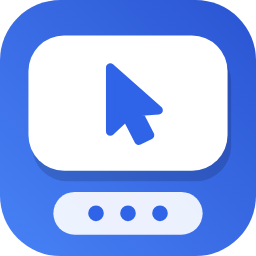
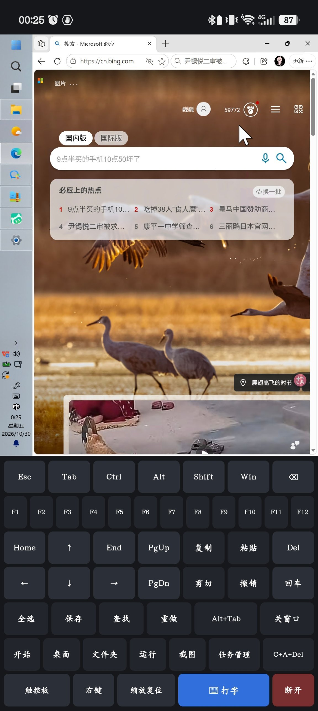
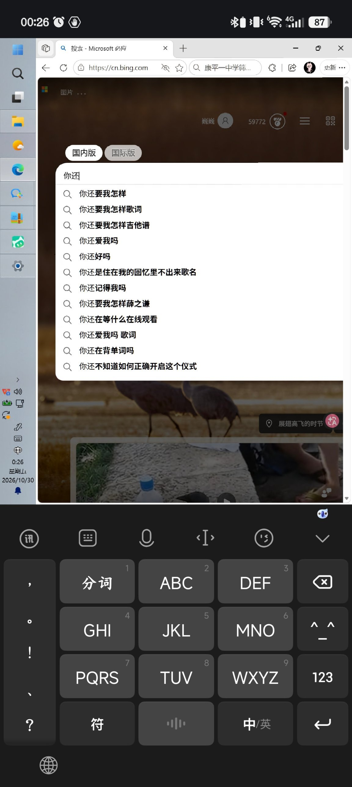

<p align="center"></p>

<h1 align="center">无遮远程 ClearRDP</h1>

<p align="center">一个专为竖屏手机设计的 Android 远程桌面（RDP）客户端：<br>
<b>键盘永远不会挡住远程桌面。</b></p>

<p align="center">
  <a href="https://github.com/icangotoanywhere/ClearRDP/releases/latest/download/ClearRDP.apk"><b>⬇ 下载 APK（最新版）</b></a>
  &nbsp;·&nbsp;
  <a href="https://github.com/icangotoanywhere/ClearRDP/releases">所有版本</a>
  &nbsp;·&nbsp;
  <a href="PRIVACY.md">隐私政策</a>
</p>
<p align="center"><sub>Android 10 及以上 · 64 位手机</sub></p>

---

## 为什么做这个

手机上的远程桌面 App 大多把电脑画面铺满整个竖屏。一弹出键盘，画面下半部分就被挡住，正在输入的地方往往刚好看不见。

无遮远程换了一种布局：远程桌面从状态栏下沿一直延伸到键盘上沿，下面留出一块与手机输入法同样高的区域。平时这里是快捷键盘；要打字时，手机自带的输入法弹出来，正好盖住这一块，远程画面一点也不被遮挡。

<table align="center">
  <tr>
    <td align="center"></td>
    <td align="center"></td>
  </tr>
  <tr>
    <td align="center">平时：快捷键盘</td>
    <td align="center">打字时：手机输入法盖住快捷键盘</td>
  </tr>
</table>

远程桌面的分辨率就按上面那块区域来定，画面不缩放、不变形，键盘弹出或收起时也不会跳动。

## 功能

- **画面不被遮挡**：远程画面固定在键盘区以上，输入法弹出时只盖住快捷键盘
- **快捷键盘**：Esc、Tab、Ctrl / Alt / Shift / Win（点一下只管下一个键，再点一下锁定），F1–F12，方向键，Home / End / PgUp / PgDn，复制、粘贴、剪切、撤销、重做、全选、保存、查找，Alt+Tab、关窗口、开始菜单、显示桌面、资源管理器、运行、截图、任务管理器、Ctrl+Alt+Del（通过 Ctrl+Alt+End 发送）
- **输入法**：点「⌨ 打字」弹出手机自带输入法，中文拼音在本机选词，选好的字直接发到电脑上
- **两种操作模式**
  - 触控板：单指移动鼠标，轻点是左键，长按或两指轻点是右键，点两下再拖是拖动，两指上下滑是滚轮
  - 直接点：点哪儿就点击哪儿
  - 两种模式都支持双指捏合放大
- **画质两档**：「清晰」文字锐利，适合办公；「流畅」用 H.264，适合看视频或网络较慢时
- **界面缩放**：100%–300% 可选，默认 175%，在手机屏幕上也能看清电脑上的字
- **双向剪贴板**，远程声音可在手机上播放
- **多台电脑**：保存地址、用户名和密码，点一下即可连接

## 使用前提

- 被控电脑须为 Windows 专业版、企业版或服务器版，并已在「设置 → 系统 → 远程桌面」中开启远程桌面
- 手机必须能直接访问到这台电脑：同一局域网，或通过端口映射、组网工具（如 Tailscale、ZeroTier）、VPN
- Android 10 及以上，64 位（arm64-v8a）手机

## 下载

直接下载最新版：[ClearRDP.apk](https://github.com/icangotoanywhere/ClearRDP/releases/latest/download/ClearRDP.apk)，历史版本见 [Releases](https://github.com/icangotoanywhere/ClearRDP/releases)。

## 自己编译

```bash
# 1. 取得 FreeRDP 原生库（从 F-Droid 下载官方 aFreeRDP 3.32.1 并校验 SHA-256）
./scripts/fetch-freerdp-libs.sh        # Windows 下运行 scripts\fetch-freerdp-libs.ps1

# 2. 编译（需要 JDK 17 与 Android SDK 35）
./gradlew assembleRelease
```

每次推送到 main，GitHub Actions 都会自动编译。如果 `app/build.gradle.kts` 里的 `versionName` 还没有对应的 Release，就会自动建 `v版本号` 标签并发布，APK 挂在 Release 上。

## 技术说明

- RDP 协议、加解密和画面编解码由 [FreeRDP](https://github.com/FreeRDP/FreeRDP) 3.32.1 完成。为了省去在本地交叉编译整套 C 库，本项目直接使用 F-Droid 上官方 aFreeRDP 安装包里的 arm64 原生库。
- `com.freerdp.freerdpcore.services.LibFreeRDP` 是 JNI 接口类，原生库按名字调用其中的方法，所以包名、类名和方法签名都必须保持原样。
- 界面部分是纯 Java + Android SDK，没有第三方依赖。

## 隐私

本应用不收集、不上传任何个人信息，只连接你自己填写的电脑。详见[隐私政策](PRIVACY.md)。

## 许可

- 本项目代码采用 [Apache License 2.0](LICENSE)，与 FreeRDP 相同
- `LibFreeRDP.java` 改编自 aFreeRDP，按 [MPL-2.0](https://mozilla.org/MPL/2.0/) 授权
- FreeRDP 原生库及其依赖库（OpenSSL、FFmpeg、openh264 等）遵循各自的许可证

## 致谢

感谢 [FreeRDP](https://www.freerdp.com/) 项目及 aFreeRDP 的维护者。
